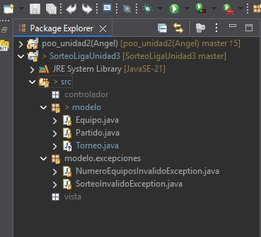
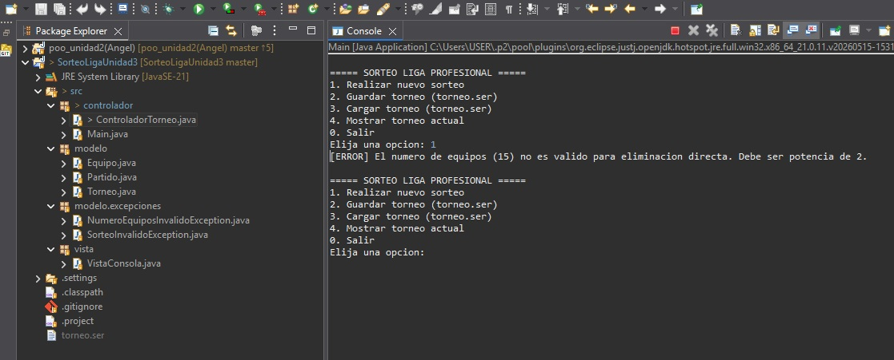
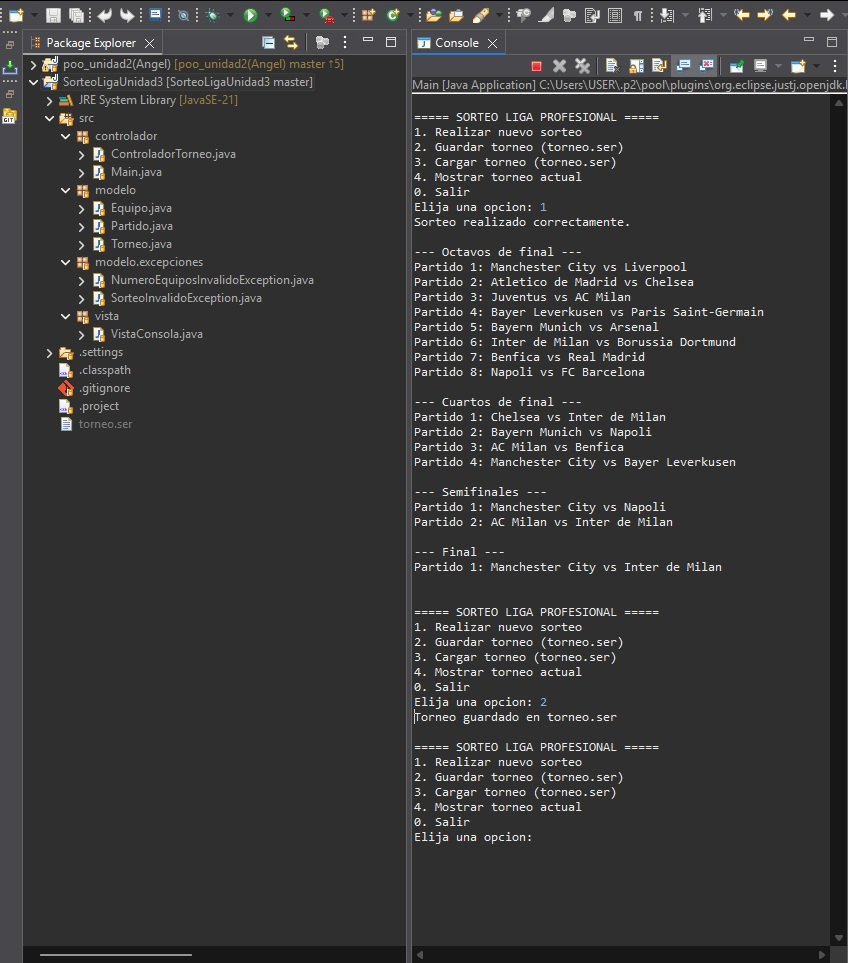
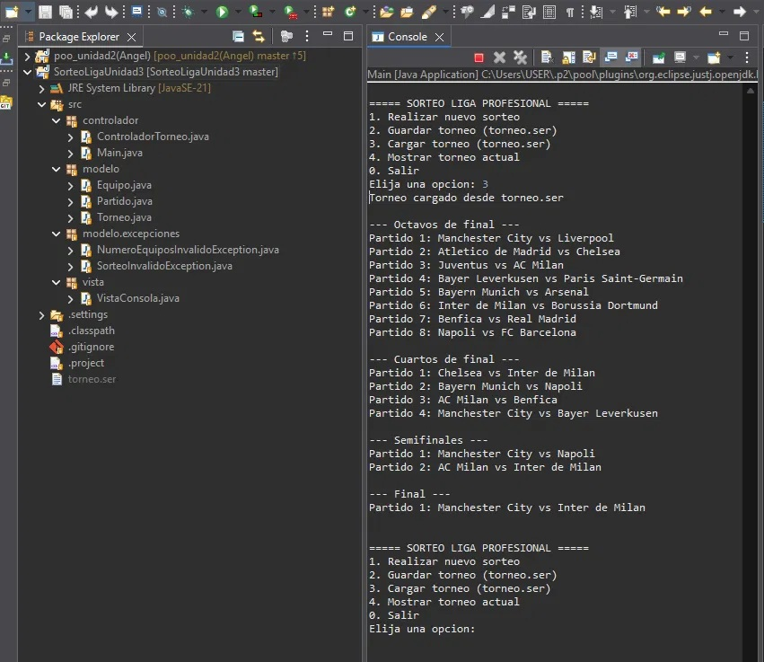
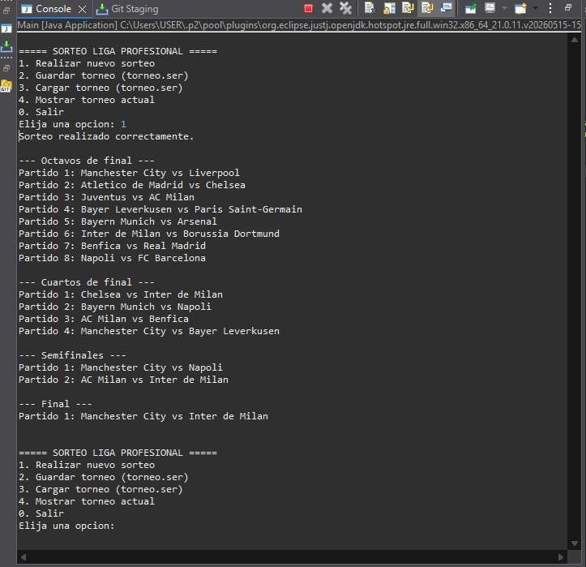
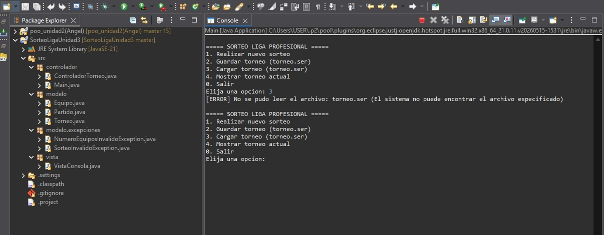
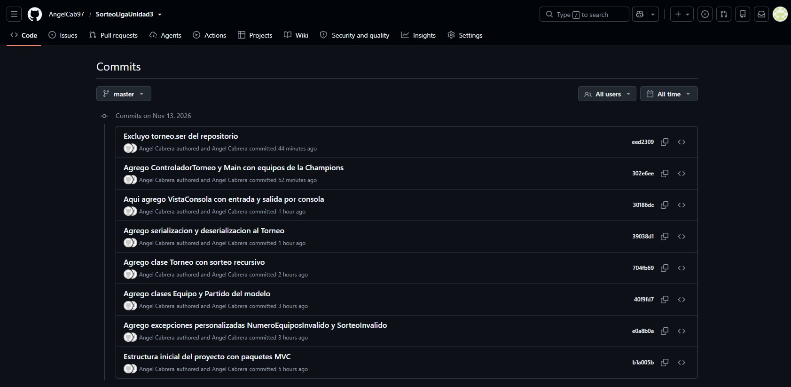

# Sorteo de equipos para una liga profesional

**Universidad Politécnica Salesiana**

**Carrera:** Software

**Asignatura:** Programación Orientada a Objetos

**Nombre:** Ángel Aurelio Cabrera Chuchuca

**Docente:** Gustavo Navas

**Curso:** Grupo 1

**Fecha:** 14/11/2026

**Actividad:** Tarea 1, Unidad 3: Sorteo de equipos para una liga profesional.

---

## Descripción

Aplicación de consola en Java que realiza el sorteo de una liga de 16 equipos de la Champions League por etapas de eliminación directa: octavos, cuartos, semifinales y final. El proyecto usa el patrón MVC, excepciones personalizadas, serialización de objetos para guardar y cargar el torneo, y un algoritmo de emparejamiento recursivo.

## Estructura del proyecto (MVC)

El proyecto está organizado en paquetes lógicos que separan las responsabilidades según el patrón Modelo-Vista-Controlador:

- **modelo**: contiene `Equipo`, `Partido` y `Torneo`. Maneja los datos, las reglas del torneo, el sorteo recursivo y la persistencia.
- **modelo.excepciones**: contiene `NumeroEquiposInvalidoException` y `SorteoInvalidoException`, las excepciones personalizadas del sorteo.
- **vista**: contiene `VistaConsola`. Se encarga de la entrada y salida por consola, sin lógica de negocio.
- **controlador**: contiene `ControladorTorneo` y `Main`. Es el intermediario entre la vista y el modelo, y captura las excepciones.

## Algoritmo de sorteo recursivo

El sorteo se hace en el método `emparejar` de la clase `Torneo`, que es recursivo: no usa ciclos para recorrer los equipos, se llama a sí mismo.

- **Preparación:** en cada etapa se mezcla la lista de equipos una sola vez con `Collections.shuffle`, lo que da el orden aleatorio.
- **Caso base:** cuando el índice llega al final de la lista, ya no quedan equipos por emparejar y la recursión termina.
- **Paso recursivo:** se crea un partido entre el equipo del índice actual y el siguiente, y el método se llama de nuevo con el índice aumentado en 2.
- **Validaciones:** si un equipo queda sin oponente, se enfrenta a sí mismo o aparece repetido en la misma etapa, se lanza `SorteoInvalidoException`.
- **Avance de etapas:** de cada partido se elige un ganador al azar, y esos ganadores forman la lista de la siguiente etapa (octavos, cuartos, semifinales y final).

## Excepciones personalizadas

El proyecto define dos excepciones propias en el paquete `modelo.excepciones`. Ambas extienden `Exception` y tienen un constructor que recibe un mensaje descriptivo y lo pasa a la superclase con `super(mensaje)`.

- **NumeroEquiposInvalidoException:** se lanza en `Torneo.realizarSorteo()` cuando la cantidad de equipos de una etapa no es potencia de 2 (16, 8, 4, 2), porque no sería posible un torneo de eliminación directa.
- **SorteoInvalidoException:** se lanza desde el método recursivo `emparejar` cuando el sorteo encuentra una condición imposible: un equipo sin oponente, un equipo enfrentado a sí mismo o un equipo repetido en la misma etapa.

Ambas se capturan con bloques `try-catch` en el controlador, que muestra el mensaje de error a través de la vista y devuelve al usuario al menú sin detener el programa.

Para probar `NumeroEquiposInvalidoException`, se quitó temporalmente un equipo de la lista (quedaron 15) y se ejecutó el sorteo. El programa mostró el error y no se cayó:

## Persistencia (serialización)

El estado del torneo se guarda en un archivo binario llamado `torneo.ser`. Para lograrlo, las clases `Torneo`, `Equipo` y `Partido` implementan `java.io.Serializable`. Todas deben ser serializables, porque el torneo contiene una lista de equipos y los partidos de cada etapa.

- **Guardar:** el método `guardar` de `Torneo` abre un `ObjectOutputStream` sobre un `FileOutputStream` y escribe el objeto completo con `writeObject`.
- **Cargar:** el método estático `cargar` usa un `ObjectInputStream` sobre un `FileInputStream` y reconstruye el torneo con `readObject`.
- **Manejo de errores:** ambos métodos declaran `IOException`, y `cargar` también `ClassNotFoundException`. El controlador los captura con `try-catch` y muestra el error mediante la vista.

El archivo `torneo.ser` está incluido en el `.gitignore`, por lo que no se sube al repositorio.

Al elegir la opción 2 del menú, el torneo se guarda y el archivo aparece en la raíz del proyecto:

Al volver a ejecutar el programa y elegir la opción 3, se carga el mismo torneo sin hacer un nuevo sorteo, lo que demuestra que la persistencia funciona:

## Ejecución y pruebas

La aplicación se ejecuta desde `Main.java` y muestra un menú por consola con estas opciones: realizar un nuevo sorteo, guardar el torneo, cargar el torneo, mostrar el torneo actual y salir.

### Sorteo completo

Al elegir la opción 1 se sortean todas las etapas: 8 partidos de octavos, 4 de cuartos, 2 de semifinales y la final. En cada etapa ningún equipo se repite, y los equipos de una etapa son los ganadores de la anterior:

### Error al cargar un archivo inexistente

Para probar el manejo de `IOException`, se eliminó `torneo.ser` y se eligió la opción 3. El programa no se cayó: mostró el mensaje de error y volvió al menú:

## Control de versiones

El código está en un repositorio público de GitHub y se fue subiendo con commits periódicos que documentan cada etapa del desarrollo: estructura inicial, excepciones, clases del modelo, sorteo recursivo, serialización, vista, controlador y configuración del `.gitignore`.

Repositorio: https://github.com/AngelCab97/SorteoLigaUnidad3

